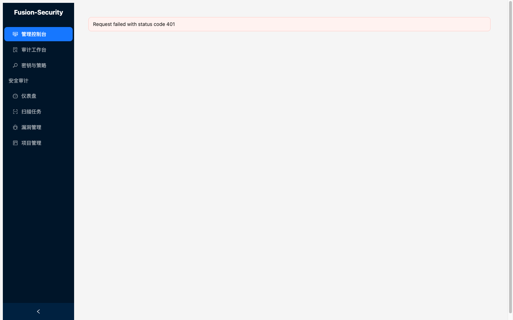

# fusion-security

macOS Apple Silicon 原生的本地 AI 代码安全审计工具。100% 离线、代码不出境，推理由 fusion-mlx 提供；React 18 + Ant Design 5 Web Dashboard 与 FastAPI REST API 同进程交付。

## 产品能力

| 能力 | 说明 | 你不再需要做的事 | 约束 |
|------|------|------------------|------|
| 六阶段扫描管线 | `scan --pipeline`：Recon→Discover→Verify→Triage→Patch→Retest，支持断点续扫与熔断 | 不必自建扫描状态机或恢复逻辑 | `scan` 不带 `--pipeline` 时走 legacy 单遍批扫（结果等价，无阶段/断点） |
| 多语言静态分析 | tree-sitter AST，覆盖 Python / JavaScript / Java / Go / C / C++ / Rust / Ruby / PHP，37 条规则 | 不必为每门语言接独立分析器 | 规则集随仓库内置，`fusion-security rules` 查看 |
| AI 语义分析 | 跨文件数据流 + fusion-mlx 语义判读，对抗验证降低误报 | 不必把代码上传到云端服务做审计 | 需要 fusion-mlx 运行；`--no-ai` 可纯规则快速扫描 |
| SCA 依赖扫描 | 默认离线本地已知漏洞库；`--osv` 才联网查询 OSV.dev | 不必为依赖清单单独跑另一款 SCA | `--osv` 会把依赖列表发往 osv.dev，破坏离线承诺 |
| CI 质量门禁 | `check`（JSON）/ `gate`（pass/fail，strict/standard/permissive）/ `sarif` 输出 | 不必为 CI 单独封装结果解析 | check/gate/sarif 走纯规则路径（无 AI），速度优先 |
| Web Dashboard | React 18 + AntD 5 + Vite；Admin Console / 审计工作台 / 密钥与策略 / 扫描 / 漏洞 / 项目页 | 不必自建审计后台或密钥台账界面 | 依赖 `frontend/dist` 构建产物；API key 认证；桌面端专用（PRD §8.1） |
| REST API | FastAPI，默认 11454；多租户（fusion-identity）、RBAC 三级角色、API key 哈希存储 | 不必自建租户隔离与密钥管理 | `/api/*` 强制租户鉴权（fail-closed），仅 `/api/v1/system/health` 公开 |
| 通知与 CI 集成 | 飞书 / 钉钉 Webhook（HMAC-SHA256 签名）；GitHub Actions / GitLab CI 模板 | 不必手写通知签名或流水线集成脚本 | Webhook 出站 URL 经 SSRF 守卫校验 |
| K8s 部署 | Helm Chart（`deploy/helm/fusion-security/`） | 不必手写部署清单 | 见 chart README |

## 安全基线

- SSRF 守卫：Webhook / 通知外发 URL 校验私网 / loopback / link-local / metadata IP；跟随重定向但每一跳 `Location` 重新校验并按请求钉定 DNS（`engine/ci/_url_guard.py`）。
- 密钥存储：API key 仅以 sha256 哈希入库，明文只在创建响应中出现一次；Webhook secret 用 Fernet 加密存储（密钥由 `FUSION_SECURITY_MASTER_KEY` 派生）。
- 日志脱敏：`password` / `api_key` / `token` / `Bearer` / `Authorization` 值在进入 stdout 与日志文件前被过滤。
- DB 文件权限：SQLite 初始化时经 `umask 0o077` 创建 `0600` 文件；CORS 拒绝 `FUSION_CORS_ORIGINS=*`。
- 限流与配额：按 `(client_ip, api_key)` 滑动窗口限流（默认 120/分钟，超限 429），每租户并发扫描默认上限 4（超限 409）。

## 端口

| 端口 | 用途 |
|------|------|
| 11454 | API 服务（默认；`start.sh` / `fusion-security serve`） |
| 11476 | 前端独立 dev server（`npm run dev`，/api 代理到 11454） |
| 11470 | fusion-identity（上游依赖，可配置） |

## 界面

Dashboard 实际截图（未配置 API key 时的初始状态——应用按 fail-closed 设计对匿名请求显示 401 提示，配置 key 后各页加载真实数据）：

## 文档索引

- 快速上手：[get-started.md](get-started.md)
- 故障排查：[troubleshooting.md](troubleshooting.md)
- API 明细：[api.md](api.md)
- 性能基准：[benchmark.md](benchmark.md)
- 安全自评：[security-self-assessment.md](security-self-assessment.md)
- 变更记录：[CHANGELOG.md](../CHANGELOG.md)
- 界面截图：[img/](img/)
